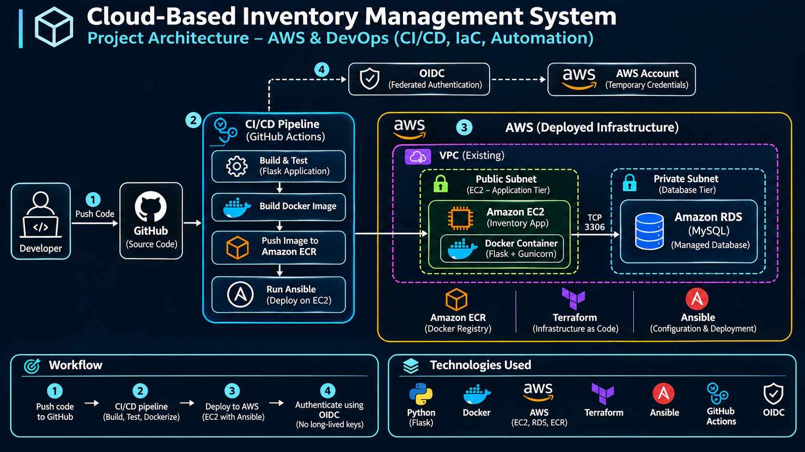
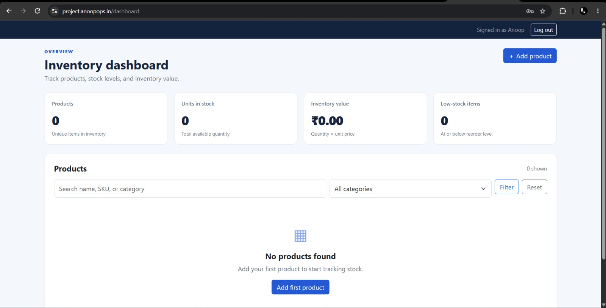

# StockWise – Cloud-Based Inventory Management System

A cloud-based inventory management application built using **Python Flask, MySQL, Docker, AWS, Ansible, Terraform and GitHub Actions**.

StockWise provides user authentication and inventory management functionality. The application is containerized with Docker and deployed on Amazon EC2. Amazon RDS provides persistent MySQL database storage, while GitHub Actions automates testing, image publishing and deployment.

---

## Table of Contents

1. [Project Overview](#1-project-overview)
2. [Features](#2-features)
3. [Technology Stack](#3-technology-stack)
4. [System Architecture](#4-system-architecture)
5. [Application Components](#5-application-components)
6. [Repository Structure](#6-repository-structure)
7. [Database Architecture](#7-database-architecture)
8. [Local Development Setup](#8-local-development-setup)
9. [Docker Setup](#9-docker-setup)
10. [AWS Infrastructure](#10-aws-infrastructure)
11. [Terraform Infrastructure Provisioning](#11-terraform-infrastructure-provisioning)
12. [Ansible Configuration Management](#12-ansible-configuration-management)
13. [CI/CD Pipeline](#13-cicd-pipeline)
14. [GitHub Actions Configuration](#14-github-actions-configuration)
15. [Complete Deployment Procedure](#15-complete-deployment-procedure)
16. [Security Implementation](#16-security-implementation)
17. [Health Checks and Verification](#17-health-checks-and-verification)
18. [Troubleshooting](#18-troubleshooting)
19. [Cleanup and Resource Management](#19-cleanup-and-resource-management)
20. [Future Improvements](#20-future-improvements)

---

## 1. Project Overview

StockWise is designed to provide a centralized inventory management platform where users can manage products and monitor stock levels.

The application uses Flask for backend development, HTML, CSS and JavaScript for the frontend, and MySQL for persistent data storage.

The application is deployed using a container-based architecture on AWS.

The deployment process combines:

- Docker for application containerization.
- Amazon EC2 for application hosting.
- Amazon RDS for MySQL database storage.
- Amazon ECR for Docker image storage.
- Terraform for infrastructure provisioning.
- Ansible for server configuration and application deployment.
- GitHub Actions for continuous integration and continuous deployment.
- AWS IAM and OpenID Connect (OIDC) for secure GitHub-to-AWS authentication.
- Ansible Vault for sensitive configuration management.

The objective is to automate application testing, container image publishing, infrastructure provisioning and application deployment.

**Current infrastructure approach:** Supporting AWS resources such as the VPC, subnets, security groups, IAM instance profile, key pair and ECR repository must be created manually. Terraform provisions the EC2 instance and RDS database using those existing resources.

---

## 2. Features

### User Management

- User registration.
- User login and logout.
- Password hashing.
- Session-based authentication.
- CSRF protection.

### Inventory Management

- Add new products.
- Edit existing products.
- Delete products.
- Store SKU, product name, category, price and quantity.
- User-specific inventory records.

### Dashboard

- Inventory statistics.
- Total product information.
- Stock quantity information.
- Low-stock alerts.
- Product search.
- Category filtering.

### Application and Infrastructure

- Flask application.
- MySQL database integration.
- Docker-based deployment.
- AWS RDS persistent database.
- Nginx reverse proxy.
- HTTPS configuration using Certbot and Let's Encrypt.
- Application health checks.
- Automated deployment using GitHub Actions and Ansible.

---

## 3. Technology Stack

| Category                 | Technology              |
| ------------------------ | ----------------------- |
| Backend                  | Python 3.12             |
| Web Framework            | Flask                   |
| Frontend                 | HTML5, CSS3, JavaScript |
| ORM                      | SQLAlchemy 2.x          |
| Database                 | MySQL 8.0.46            |
| Database Driver          | PyMySQL                 |
| Application Server       | Gunicorn                |
| Containerization         | Docker                  |
| Container Registry       | Amazon ECR              |
| Web Server               | Nginx                   |
| Cloud Platform           | AWS                     |
| Compute                  | Amazon EC2              |
| Database Service         | Amazon RDS              |
| Infrastructure as Code   | Terraform               |
| Configuration Management | Ansible                 |
| CI/CD                    | GitHub Actions          |
| Authentication           | AWS IAM and GitHub OIDC |
| Secrets Management       | Ansible Vault           |
| HTTPS                    | Certbot / Let's Encrypt |
| Version Control          | Git and GitHub          |

---

## 4. System Architecture

The application uses a three-layer deployment architecture.

### Application Request Flow

1. The user accesses the application through a web browser.
2. DNS resolves the application domain to the EC2 public IP address.
3. Nginx receives the incoming HTTP/HTTPS request.
4. Nginx forwards the request to the Flask application.
5. Gunicorn serves the Flask application inside a Docker container.
6. Flask communicates with Amazon RDS MySQL through SQLAlchemy and PyMySQL.
7. Application records are stored persistently in Amazon RDS.

### CI/CD Architecture Flow

1. Developer pushes code to the GitHub `main` branch.
2. GitHub Actions starts the CD workflow.
3. The CI workflow runs automated tests using MySQL 8.0.
4. Docker image build validation is performed.
5. GitHub Actions authenticates with AWS using OIDC.
6. A Docker image is built and pushed to Amazon ECR.
7. GitHub Actions temporarily authorizes its runner to connect to EC2 over SSH.
8. Ansible connects to EC2 and configures the application.
9. The new Docker image is deployed.
10. Application health checks are performed.
11. Temporary SSH access is revoked.
12. Temporary deployment files are removed.

The following diagram illustrates the AWS infrastructure, application request flow, and automated CI/CD deployment pipeline.

### AWS Architecture Diagram



---

## 5. Application Components

### Flask Backend

The Flask application handles:

- User registration and authentication.
- Session management.
- Product CRUD operations.
- Dashboard information.
- Product filtering and search.
- Database interactions.
- Health-check requests.

### Frontend

The frontend uses:

- HTML templates.
- CSS styling.
- JavaScript interactions.

### Database Layer

SQLAlchemy manages database operations, while PyMySQL provides connectivity to MySQL.

The application uses environment-driven configuration rather than hardcoded database credentials.

### Application Startup

The application startup process performs operations including:

1. Validating application configuration.
2. Checking database connectivity.
3. Waiting for MySQL to become available.
4. Creating missing application tables using SQLAlchemy metadata.
5. Starting Gunicorn after successful database initialization.

Application records are stored in Amazon RDS rather than inside the Docker container.

## Application User Interface

The following screenshot shows the deployed StockWise inventory management dashboard, including inventory statistics, product management, search, and category filtering.

### Inventory Dashboard



---

## 6. Repository Structure

```text
inventory-management-system/
│
├── .github/
│   └── workflows/
│       ├── ci.yml
│       └── cd.yml
│
├── ansible/
│   ├── group_vars/
│   │   ├── all.yml
│   │   └── webservers/
│   │       └── vault.yml.example
│   │
│   ├── templates/
│   │   ├── inventory-app-http.conf.j2
│   │   └── inventory-app-https.conf.j2
│   │
│   ├── ansible.cfg
│   ├── inventory.ini
│   ├── requirements.yml
│   └── site.yml
│
├── terraform/
│   ├── .gitignore
│   ├── .terraform.lock.hcl
│   ├── data.tf
│   ├── deploy.ps1
│   ├── ec2.tf
│   ├── outputs.tf
│   ├── provider.tf
│   ├── rds.tf
│   ├── security_groups.tf
│   ├── variables.tf
│   └── versions.tf
│
├── static/
│   └── style.css
│
├── templates/
│   ├── base.html
│   ├── dashboard.html
│   ├── error.html
│   ├── login.html
│   ├── product_form.html
│   └── register.html
│
├── tests/
│   ├── conftest.py
│   ├── test_app.py
│   └── test_settings.py
│
├── .dockerignore
├── .env.example
├── .gitignore
├── app.py
├── compose.yaml
├── database.py
├── Dockerfile
├── entrypoint.py
├── init_db.py
├── models.py
├── requirements.txt
├── settings.py
├── CICD.md
└── README.md
```

**Note:** The actual repository may contain additional files. The encrypted Ansible Vault file `vault.yml` must be maintained locally and must not be published. Use `vault.yml.example` as a reference.

---

## 7. Database Architecture

The project uses Amazon RDS MySQL as its persistent database.

### Database Configuration

| Configuration          | Value         |
| ---------------------- | ------------- |
| Database Engine        | MySQL         |
| Engine Version         | 8.0.46        |
| Database Name          | inventorydb   |
| Database Administrator | dbadmin       |
| Application User       | inventoryuser |
| Database Port          | 3306          |
| Production SSL Mode    | verify-full   |

Database credentials are provided through environment variables and encrypted Ansible Vault values.

### Database Connectivity

The application connects to the RDS endpoint using:

- SQLAlchemy.
- PyMySQL.
- Database connection pooling.
- TLS certificate verification.

The production application uses `verify-full` SSL mode to verify the RDS certificate and hostname.

The RDS database is not publicly accessible. Its security group permits database traffic from the EC2 security group.

### Database Persistence

Database records are stored independently of the EC2 instance and Docker container.

Replacing an application container does not delete database records.

Creating a new RDS instance creates a separate database. Existing records are not automatically transferred to it.

### Table Initialization

The `entrypoint.py` and `init_db.py` files handle database initialization and table creation.

The project currently uses SQLAlchemy `create_all()` for initial schema creation rather than a dedicated migration framework.

---

## 8. Local Development Setup

### Prerequisites

Install:

- Python 3.12.
- MySQL 8.0.
- Git.
- Docker (optional for container testing).

### Step 1: Clone the Repository

```bash
git clone https://github.com/YOUR_USERNAME/YOUR_REPOSITORY.git
cd YOUR_REPOSITORY
```

Replace `YOUR_USERNAME` and `YOUR_REPOSITORY` with the correct GitHub details.

### Step 2: Create a Virtual Environment

Windows PowerShell:

```powershell
python -m venv venv
.\venv\Scripts\Activate.ps1
```

Linux:

```bash
python3 -m venv venv
source venv/bin/activate
```

### Step 3: Install Dependencies

```bash
python -m pip install --upgrade pip
pip install -r requirements.txt
```

### Step 4: Create a MySQL Database

Connect to your local MySQL server:

```sql
CREATE DATABASE inventorydb;
```

Create an application user and grant the necessary permissions for local development.

Do not use RDS administrator credentials as the application's production credentials.

### Step 5: Configure Environment Variables

Copy the example file.

Windows PowerShell:

```powershell
Copy-Item .env.example .env
```

Linux:

```bash
cp .env.example .env
```

Edit `.env` and configure the database credentials:

```env
SECRET_KEY=replace-with-a-long-random-secret
COOKIE_SECURE=0

DB_HOST=127.0.0.1
DB_PORT=3306
DB_NAME=inventorydb
DB_USER=inventoryuser
DB_PASSWORD=your-local-database-password

DB_SSL_MODE=disabled
```

Use `DB_SSL_MODE=disabled` only for a local development database without TLS.

For Amazon RDS, configure `verify-full` and the appropriate RDS CA bundle.

Never commit `.env` to GitHub.

### Step 6: Initialize the Database

```bash
python init_db.py
```

### Step 7: Run the Application

```bash
python app.py
```

Open the application:

```text
http://127.0.0.1:5000
```

---

## 9. Docker Setup

Docker packages the Flask application and its dependencies into a container.

### Build the Docker Image

```bash
docker build -t inventory-management-system:local .
```

### Configure Environment Variables

Copy `.env.example` to `.env` and configure the database settings.

The container requires an existing MySQL server. The Compose configuration does not create a MySQL database service.

### Start the Application

```bash
docker compose up -d --build
```

The Compose configuration maps the application to:

```text
127.0.0.1:5000
```

This binding keeps the local application port accessible only from the local machine.

### Verify the Container

```bash
docker ps
```

Check container logs:

```bash
docker logs inventory-app
```

The container name may differ when using local Compose. Check `docker ps` for the actual name.

### Verify Application Health

```bash
curl http://127.0.0.1:5000/healthz
```

### Stop the Container

```bash
docker compose down
```

The application image does not contain persistent database records. Data remains in the configured MySQL database.

---

## 10. AWS Infrastructure

The production deployment uses the following AWS services.

| AWS Service                | Purpose                       |
| -------------------------- | ----------------------------- |
| Amazon VPC                 | Network isolation             |
| Public and private subnets | Network segmentation          |
| Route Tables               | Network routing               |
| Internet Gateway           | Public internet connectivity  |
| Security Groups            | Network traffic control       |
| Amazon EC2                 | Application hosting           |
| Amazon EBS                 | EC2 block storage             |
| Amazon RDS                 | Persistent MySQL database     |
| Amazon ECR                 | Docker image repository       |
| AWS IAM                    | Access control                |
| AWS OIDC                   | GitHub Actions authentication |

### EC2

The EC2 instance hosts:

- Docker Engine.
- Nginx.
- Flask application container.
- Ansible-managed configuration.
- Certbot and HTTPS configuration.

The application container listens on port 5000 and is exposed locally on the EC2 host. Nginx acts as the public reverse proxy.

### RDS

Amazon RDS hosts MySQL 8.0.46.

The database is configured as a private database and is not directly exposed to the internet.

The application connects to RDS through the EC2 instance's network access.

### Security Group Traffic

Typical inbound rules:

| Destination | Port | Source                                                         |
| ----------- | ---: | -------------------------------------------------------------- |
| SSH         |   22 | Authorized administrator IP and temporary deployment runner IP |
| HTTP        |   80 | Public internet                                                |
| HTTPS       |  443 | Public internet                                                |
| MySQL       | 3306 | EC2 security group only                                        |

Do not expose MySQL port 3306 to `0.0.0.0/0`.

---

## 11. Terraform Infrastructure Provisioning

Terraform is used to provision the application EC2 instance and RDS database infrastructure.

### Terraform Files

| File                 | Purpose                                         |
| -------------------- | ----------------------------------------------- |
| `versions.tf`        | Terraform and AWS provider version requirements |
| `provider.tf`        | AWS provider configuration                      |
| `variables.tf`       | Infrastructure variables                        |
| `data.tf`            | References existing AWS resources               |
| `security_groups.tf` | References existing security groups             |
| `ec2.tf`             | EC2 instance configuration                      |
| `rds.tf`             | RDS MySQL and subnet group configuration        |
| `outputs.tf`         | Infrastructure outputs                          |
| `deploy.ps1`         | Windows PowerShell deployment helper            |

### Important: Existing AWS Resources

The current Terraform configuration does not create a complete AWS networking environment.

The following resources must be created manually before running the deployment script:

1. AWS VPC.
2. At least two subnets in different Availability Zones.
3. An EC2 subnet suitable for public IP assignment.
4. EC2 security group.
5. RDS security group.
6. IAM role and instance profile for EC2.
7. EC2 key pair.
8. Amazon ECR repository.

The RDS subnet group is created by Terraform using the existing subnets in the selected VPC. The VPC must have suitable subnets in at least two Availability Zones.

### 11.1 Create a VPC

Create a VPC from the AWS Management Console.

Example configuration:

| Setting   | Example       |
| --------- | ------------- |
| VPC Name  | inventory-vpc |
| IPv4 CIDR | 10.0.0.0/16   |

You can use your own CIDR range, provided it does not conflict with other networks.

### 11.2 Create Subnets

Create at least two subnets in different Availability Zones.

Example:

| Subnet           | CIDR        | Availability Zone | Purpose |
| ---------------- | ----------- | ----------------- | ------- |
| Public Subnet    | 10.0.1.0/24 | ap-south-1a       | EC2     |
| Private Subnet A | 10.0.2.0/24 | ap-south-1a       | RDS     |
| Private Subnet B | 10.0.3.0/24 | ap-south-1b       | RDS     |

The EC2 subnet must have the appropriate public routing and public IP assignment for the deployment design.

The RDS subnet group needs subnets in at least two different Availability Zones.

### 11.3 Configure Route Tables

For the public subnet:

1. Create or select a route table.
2. Associate it with the public subnet.
3. Add a route:

```text
Destination: 0.0.0.0/0
Target: Internet Gateway
```

For private subnets, configure the routing appropriate to your environment. If private instances need outbound internet access, configure a NAT Gateway or another suitable egress method.

### 11.4 Create an EC2 Security Group

Create a security group for the EC2 instance.

Example name:

```text
inventory-ec2-sg
```

Configure inbound rules:

| Type  | Port | Source         |
| ----- | ---: | -------------- |
| SSH   |   22 | Your public IP |
| HTTP  |   80 | 0.0.0.0/0      |
| HTTPS |  443 | 0.0.0.0/0      |

Do not leave SSH open to the entire internet unless there is a specific temporary requirement.

### 11.5 Create an RDS Security Group

Create a security group for the RDS database.

Example name:

```text
inventory-rds-sg
```

Configure the following inbound rule:

| Type         | Port | Source             |
| ------------ | ---: | ------------------ |
| MySQL/Aurora | 3306 | EC2 security group |

Use the EC2 security group as the source. Do not use `0.0.0.0/0`.

### 11.6 Create an IAM Role and Instance Profile

Create an IAM role for EC2.

Configure:

```text
Trusted entity: AWS service
Use case: EC2
```

Attach the permissions required by the application.

The EC2 instance role needs permission to authenticate to Amazon ECR and pull the application image.

The role must also contain any other AWS permissions required by the actual application deployment.

Create or use an instance profile associated with the role.

Example instance profile name:

```text
InventoryAppEC2Role
```

The instance profile name must match the Terraform configuration.

### 11.7 Create an EC2 Key Pair

Create an EC2 key pair in the same AWS region.

Download the private key and store it securely on your local Windows machine.

Example:

```text
D:\YOUR-KEY.pem
```

Do not upload the private key to GitHub.

The key name and local key path must match the configuration used by the deployment script and Terraform.

### 11.8 Create an ECR Repository

Open Amazon ECR and create a private repository.

Repository name:

```text
inventory-management-system
```

The repository name must match the Terraform data source and CI/CD workflow.

### 11.9 Configure Terraform Values

Before running Terraform, update the account-specific configuration in the following files:

```text
terraform/
├── data.tf
├── security_groups.tf
├── variables.tf
├── provider.tf
└── deploy.ps1
```

Update:

- AWS account ID.
- AWS region.
- VPC ID.
- EC2 subnet ID.
- EC2 security group ID.
- RDS security group ID.
- AMI ID compatible with the deployment configuration.
- EC2 key pair name.
- IAM instance profile name.
- Local SSH private key path.
- AWS CLI profile name.

The current deployment helper contains hardcoded values for the original development environment. Replace those values with your own AWS resource details before execution.

Do not publish personal AWS account IDs, private key paths or resource IDs in your public repository.

### 11.10 Configure AWS CLI

Install AWS CLI and Terraform on your Windows machine.

Configure an AWS CLI profile:

```powershell
aws configure --profile YOUR_AWS_PROFILE
```

Verify AWS authentication:

```powershell
aws sts get-caller-identity --profile YOUR_AWS_PROFILE
```

Make sure the returned AWS account is the account where you created the prerequisite resources.

### 11.11 Run the Deployment Script

Open PowerShell from the project directory:

```powershell
cd terraform
```

Run:

```powershell
.\deploy.ps1
```

The PowerShell helper performs the following operations:

1. Checks AWS CLI installation.
2. Checks Terraform installation.
3. Verifies AWS authentication.
4. Verifies the expected AWS account.
5. Checks the configured VPC and EC2 subnet.
6. Checks the EC2 and RDS security groups.
7. Checks the EC2 key pair.
8. Checks the IAM instance profile.
9. Checks the ECR repository.
10. Verifies the local SSH private key.
11. Detects the current public IP address.
12. Updates or creates the eligible SSH ingress rule.
13. Verifies or adds RDS MySQL access from the EC2 security group.
14. Verifies that the VPC has subnets in at least two Availability Zones.
15. Requests the RDS database password securely.
16. Runs Terraform initialization, formatting and validation.
17. Creates a Terraform execution plan.
18. Requests confirmation before applying the plan.
19. Creates the EC2 instance and RDS database.
20. Waits for RDS to become available.
21. Displays infrastructure outputs.

The script also generates a local `deployment-outputs.txt` file. Do not commit this file to GitHub.

### 11.12 Terraform Outputs

The configuration exposes outputs including:

- EC2 instance ID.
- EC2 public IP.
- EC2 public DNS.
- EC2 security group ID.
- RDS identifier.
- RDS endpoint.
- RDS port.
- RDS database name.
- RDS security group ID.
- ECR repository URI.
- IAM instance profile.

Record the EC2 public IP and RDS endpoint for the subsequent deployment configuration.

### Important Terraform Notes

- Terraform state files contain sensitive infrastructure information and must not be committed.
- Database passwords must be supplied securely.
- Existing resources referenced by data sources must be available.
- Review resource replacement and deletion operations carefully.
- The current RDS configuration has deletion protection disabled and skips the final snapshot.
- Destroying or replacing the database can permanently delete its data.

**The current Terraform setup provisions EC2 and RDS, not the entire AWS environment.** VPC, subnets, security groups, IAM instance profile, key pair and ECR must exist before running the script.

---

## 12. Ansible Configuration Management

Ansible automates EC2 configuration and application deployment.

The main playbook is:

```text
ansible/site.yml
```

### Ansible Tasks

The playbook performs operations including:

1. Validate deployment variables.
2. Validate encrypted secrets.
3. Optionally update system packages.
4. Install required deployment packages.
5. Install and start Docker.
6. Install and start Nginx.
7. Create the application directory.
8. Verify EC2 IAM instance role identity.
9. Verify the expected AWS account.
10. Wait for the RDS MySQL endpoint.
11. Provision the database and application user.
12. Authenticate Docker with Amazon ECR.
13. Pull the specified Docker image.
14. Replace the previous application container.
15. Start the new application container.
16. Wait for application health.
17. Configure Nginx.
18. Request or use a Let's Encrypt certificate.
19. Configure HTTPS and certificate renewal.
20. Verify the public endpoint.
21. Validate and reload Nginx.

### Ansible Inventory

The repository includes:

```text
ansible/inventory.ini
```

The inventory contains a placeholder EC2 address.

For manual deployment, configure it with:

- EC2 public IP address.
- Correct SSH username.
- Correct private key path.

The GitHub Actions workflow generates a temporary SSH inventory during automated deployment.

### Install Ansible

Install the required Ansible version:

```bash
python -m pip install ansible-core==2.20.1
```

Install the required collections:

```bash
ansible-galaxy collection install -r ansible/requirements.yml
```

### Configure Ansible Vault

Ansible Vault protects sensitive configuration values, including:

- `vault_rds_master_password` – RDS master administrator password.
- `vault_db_password` – Separate password for the Flask application's MySQL account.
- `vault_flask_secret_key` – Flask application secret key.

The encrypted file is:

```text
ansible/group_vars/webservers/vault.yml
```

The example file is:

```text
ansible/group_vars/webservers/vault.yml.example
```

The example file should contain placeholders for all three variables.

Create your own Vault file using the example:

```bash
cp group_vars/webservers/vault.yml.example group_vars/webservers/vault.yml
```

Edit `vault.yml` and enter the real values locally.

Encrypt the file:

```bash
ansible-vault encrypt group_vars/webservers/vault.yml
```

Never commit:

- The actual encrypted Vault file.
- The Vault password.
- Plaintext secrets.
- Personal credentials.

The GitHub Actions workflow uses the `ANSIBLE_VAULT_PASSWORD` repository secret to decrypt the Vault file during deployment.

### Manual Playbook Execution

After configuring the inventory, encrypted secrets and deployment variables:

```bash
cd ansible
ansible-playbook site.yml -i inventory.ini --ask-vault-pass
```

For a specific ECR image tag and database endpoint, provide the corresponding extra variables required by the playbook.

---

## 13. CI/CD Pipeline

The project uses GitHub Actions for continuous integration and continuous deployment.

There are two workflows:

```text
.github/workflows/
├── ci.yml
└── cd.yml
```

### Continuous Integration

The CI workflow is defined in:

```text
.github/workflows/ci.yml
```

It runs on:

- Pull requests targeting `main`.
- Calls from the CD workflow.
- Manual workflow dispatch.

The CI workflow performs:

1. Repository checkout.
2. Python 3.12 setup.
3. MySQL 8.0 service initialization.
4. Python dependency installation.
5. Automated pytest execution.
6. Docker image build validation.

The test database is separate from the production RDS database.

### Continuous Deployment

The CD workflow is defined in:

```text
.github/workflows/cd.yml
```

It runs on:

- Pushes to `main`.
- Manual workflow dispatch.

The CD workflow has three jobs.

### Job 1: Run CI Before Release

The CD workflow calls the reusable CI workflow.

Deployment does not proceed if the CI job fails.

### Job 2: Build and Push Image to ECR

The workflow:

1. Checks required AWS configuration.
2. Authenticates to AWS using GitHub OIDC.
3. Verifies the AWS account.
4. Logs in to Amazon ECR.
5. Generates a commit-specific image tag.
6. Builds the Docker image.
7. Pushes the Docker image to Amazon ECR.

The image tag is generated using the GitHub commit SHA:

```text
mysql-GITHUB_COMMIT_SHA
```

This provides a unique image reference for each commit.

### Job 3: Deploy to EC2 Through SSH

The deployment job:

1. Validates required deployment configuration.
2. Authenticates to AWS using OIDC.
3. Verifies the AWS account and running EC2 instance.
4. Detects the GitHub runner's public IP.
5. Temporarily authorizes SSH TCP port 22 in the EC2 security group.
6. Installs Python and Ansible.
7. Installs required Ansible collections.
8. Creates temporary SSH and Vault password files.
9. Verifies SSH connectivity.
10. Runs the Ansible deployment playbook.
11. Deploys the newly published Docker image.
12. Checks application availability.
13. Revokes temporary SSH ingress.
14. Removes temporary deployment files.

The workflow uses GitHub Actions concurrency control to prevent overlapping production deployments.

---

## 14. GitHub Actions Configuration

Configure the required repository variables and secrets before running CD.

Open:

**GitHub Repository → Settings → Secrets and variables → Actions**

### 14.1 Repository Variables

Create the following repository variables under the **Variables** tab:

| Variable                | Description                                                   |
| ----------------------- | ------------------------------------------------------------- |
| `AWS_ACCOUNT_ID`        | AWS account ID containing the deployment resources            |
| `CERTBOT_EMAIL`         | Email address used for Let's Encrypt certificate registration |
| `DOMAIN_NAME`           | Domain name used by the application and HTTPS configuration   |
| `EC2_HOST`              | Public IP address or DNS name of the EC2 instance             |
| `EC2_SECURITY_GROUP_ID` | EC2 security group ID                                         |
| `EC2_SSH_USER`          | SSH username for the EC2 instance                             |
| `RDS_ENDPOINT`          | Amazon RDS MySQL endpoint hostname                            |

Use your own AWS resource values and domain.

The workflow references repository variables using:

```yaml
${{ vars.VARIABLE_NAME }}
```

### 14.2 Repository Secrets

Create the following repository secrets under the **Secrets** tab:

| Secret                   | Description                                       |
| ------------------------ | ------------------------------------------------- |
| `ANSIBLE_VAULT_PASSWORD` | Password used to decrypt Ansible Vault            |
| `AWS_ROLE_ARN`           | IAM role ARN assumed by GitHub Actions using OIDC |
| `EC2_SSH_PRIVATE_KEY`    | Private SSH key used to connect to EC2            |

Never store private keys or passwords as ordinary repository variables.

### 14.3 Configure AWS OIDC

GitHub Actions uses OpenID Connect to obtain temporary AWS credentials.

Configure an IAM OIDC identity provider for GitHub Actions if one does not already exist.

The IAM role trust policy must allow the correct GitHub repository identity to assume the role.

For example, the trust relationship must be restricted to your repository:

```text
repo:YOUR_USERNAME/YOUR_REPOSITORY:ref:refs/heads/main
```

Use the actual subject condition required by your workflow. If the workflow uses a different GitHub environment or event context, configure the trust policy accordingly.

The IAM role also requires permissions used by the workflows, including:

- AWS identity verification.
- Amazon ECR authentication.
- Amazon ECR image publishing.
- EC2 instance discovery.
- Temporary security group ingress authorization.
- Security group ingress revocation.

Scope IAM permissions to the required resources and actions.

Do not store long-lived AWS access keys in GitHub Actions secrets for this workflow.

### 14.4 Verify GitHub Configuration

Before running CD, verify:

- AWS account ID is correct.
- Domain name is correct.
- IAM role ARN is correct.
- OIDC trust policy allows the repository.
- EC2 public address is correct.
- EC2 security group ID is correct.
- SSH username is correct.
- SSH private key is valid.
- RDS endpoint is correct.
- Ansible Vault password is correct.
- Certbot email is configured.

### 14.5 Trigger CD Automatically

Push a commit to the `main` branch:

```bash
git add .
git commit -m "Update application"
git push origin main
```

This triggers the CD workflow, which runs CI before building and deploying the image.

### 14.6 Trigger CD Manually

1. Open the GitHub repository.
2. Select the **Actions** tab.
3. Select the **CD** workflow.
4. Click **Run workflow**.
5. Select the `main` branch.
6. Click **Run workflow**.

The manual trigger executes the CD workflow, including its CI job.

### 14.7 Monitor Workflow Execution

Open the repository's Actions page and inspect:

- CI job.
- Build and push job.
- Deployment job.
- Application health-check step.
- Temporary SSH cleanup step.

A successful deployment requires the workflow to complete successfully.

**Important:** If you are publishing the repository before configuring your own AWS resources and GitHub secrets, do not trigger the CD workflow. It requires valid deployment configuration and can fail if those resources are not ready.

---

## 15. Complete Deployment Procedure

Follow the steps in order when deploying the project in your own AWS account.

### Phase 1: Prepare the Local Environment

Install the required tools on your Windows machine:

- Git.
- AWS CLI.
- Terraform.
- Python.
- Ansible.
- Docker, if needed for local testing.

Verify installations:

```powershell
git --version
aws --version
terraform version
python --version
docker --version
```

Configure AWS credentials:

```powershell
aws configure --profile YOUR_AWS_PROFILE
```

Verify the AWS identity:

```powershell
aws sts get-caller-identity --profile YOUR_AWS_PROFILE
```

### Phase 2: Create Supporting AWS Resources

Manually create:

1. VPC.
2. Public and private subnets.
3. Internet Gateway and required route tables.
4. EC2 security group.
5. RDS security group.
6. IAM role and instance profile.
7. EC2 key pair.
8. Amazon ECR repository.

Verify that the RDS subnets are in at least two Availability Zones.

### Phase 3: Configure Terraform

Update the account-specific values in:

```text
terraform/data.tf
terraform/security_groups.tf
terraform/variables.tf
terraform/provider.tf
terraform/deploy.ps1
```

Check that:

- AWS account ID is correct.
- AWS region is correct.
- VPC ID is correct.
- EC2 subnet ID is correct.
- Security group IDs are correct.
- Key pair name is correct.
- IAM instance profile exists.
- ECR repository exists.
- Local private key path is correct.
- AWS CLI profile is correct.

### Phase 4: Provision EC2 and RDS

Open PowerShell:

```powershell
cd terraform
```

Run:

```powershell
.\deploy.ps1
```

Review the Terraform plan carefully.

Confirm the apply operation only after verifying the resources that will be created or changed.

Wait for the RDS database to become available.

Record:

- EC2 public IP.
- EC2 instance ID.
- RDS endpoint.
- RDS database name.
- RDS security group ID.

### Phase 5: Configure Application Secrets

Create your Ansible Vault file:

```text
ansible/group_vars/webservers/vault.yml
```

Use the example file as a reference.

Store the following values in encrypted form:

- RDS master password.
- Application database password.
- Flask secret key.

Encrypt the file using Ansible Vault.

Do not commit the actual Vault file or Vault password.

### Phase 6: Configure GitHub Actions

Open:

**GitHub Repository → Settings → Secrets and variables → Actions**

Add the following repository variables:

```text
AWS_ACCOUNT_ID
CERTBOT_EMAIL
DOMAIN_NAME
EC2_HOST
EC2_SECURITY_GROUP_ID
EC2_SSH_USER
RDS_ENDPOINT
```

Add the following repository secrets:

```text
ANSIBLE_VAULT_PASSWORD
AWS_ROLE_ARN
EC2_SSH_PRIVATE_KEY
```

Configure the AWS OIDC provider and IAM role trust policy for the repository.

### Phase 7: Deploy the Application

Push the project to the configured GitHub repository or manually trigger the CD workflow.

The workflow will:

1. Run CI tests.
2. Build the Docker image.
3. Authenticate with Amazon ECR.
4. Push the image to ECR.
5. Temporarily authorize SSH access.
6. Connect to EC2.
7. Execute Ansible.
8. Configure Docker and Nginx.
9. Deploy the application container.
10. Configure HTTPS.
11. Verify application health.
12. Remove temporary SSH access.

### Phase 8: Verify the Application

Open the configured domain in a browser:

```text
https://YOUR_DOMAIN
```

Check the health endpoint:

```text
https://YOUR_DOMAIN/healthz
```

Verify that:

- The application loads.
- User registration works.
- User login works.
- Products can be added.
- Products can be edited.
- Products can be deleted.
- Dashboard information loads.
- Database records persist after container replacement.
- HTTPS works correctly.

---

## 16. Security Implementation

Security is addressed at the application, container, database, infrastructure and deployment levels.

### Application Security

- Password hashing.
- Session-based authentication.
- CSRF protection for POST requests.
- User-specific product access.
- Environment-driven configuration.
- Database access through SQLAlchemy.

### Container Security

- Python slim base image.
- Non-root application user.
- Container health check.
- No persistent database credentials baked into the image.
- Application data stored in RDS rather than the container filesystem.

### Database Security

- Private RDS database.
- Security group-based access control.
- TLS certificate verification.
- Separate application database credentials.
- Sensitive values managed through Ansible Vault.

### AWS Security

- IAM roles for EC2.
- GitHub OIDC authentication.
- Security group-based network restrictions.
- Encrypted EC2 root storage.
- Encrypted RDS storage.
- Temporary SSH ingress for GitHub Actions deployment.

### Secrets Handling

Never commit:

- `.env` files.
- AWS access keys.
- SSH private keys.
- Plaintext database passwords.
- Ansible Vault passwords.
- Terraform state files.
- Terraform plan files containing sensitive information.
- Generated deployment output files.
- The actual Ansible Vault file.

Use `.env.example` and `vault.yml.example` as configuration references.

---

## 17. Health Checks and Verification

### Application Health Endpoint

The application exposes:

```text
/healthz
```

Local verification:

```bash
curl http://127.0.0.1:5000/healthz
```

Production verification:

```bash
curl -f https://YOUR_DOMAIN/healthz
```

### Docker Verification

Check running containers:

```bash
docker ps
```

Check container logs:

```bash
docker logs inventory-app
```

Inspect the container:

```bash
docker inspect inventory-app
```

### Nginx Verification

Check Nginx configuration:

```bash
sudo nginx -t
```

Check Nginx service:

```bash
sudo systemctl status nginx
```

### Database Connectivity

Check whether EC2 can reach the RDS endpoint on TCP port 3306:

```bash
nc -vz YOUR_RDS_ENDPOINT 3306
```

Network connectivity alone does not prove database authentication or TLS verification is successful.

### GitHub Actions Verification

Confirm that:

- CI tests pass.
- Docker image build succeeds.
- ECR push succeeds.
- SSH connectivity succeeds.
- Ansible deployment succeeds.
- Application health checks succeed.
- Temporary SSH cleanup succeeds.

---

## 18. Troubleshooting

### Database Connection Failure

Possible causes:

- Incorrect RDS endpoint.
- Incorrect database credentials.
- RDS security group does not allow the EC2 security group.
- RDS is not available.
- Incorrect database SSL mode.
- Incorrect RDS CA bundle.

Check:

```bash
nc -vz YOUR_RDS_ENDPOINT 3306
```

Also verify the application database environment variables.

### Docker Container Not Starting

Inspect:

```bash
docker ps -a
docker logs inventory-app
```

Check the environment variables, image tag and database connectivity.

### GitHub Actions OIDC Authentication Failure

Check:

- IAM role ARN.
- IAM trust policy.
- GitHub repository identity.
- Workflow permissions.
- AWS account ID.
- OIDC provider configuration.

### SSH Connection Failure

Check:

- EC2 public IP.
- EC2 instance state.
- SSH username.
- SSH private key.
- Security group TCP port 22.
- Current administrator public IP.
- Temporary GitHub runner ingress rule.

### Ansible Deployment Failure

Check:

- SSH connectivity.
- Ansible inventory.
- Ansible Vault password.
- Encrypted variables.
- RDS connectivity.
- EC2 IAM instance role.
- ECR image availability.

### HTTPS Failure

Check:

- DNS resolution.
- Domain points to the correct EC2 address.
- Port 80 and 443 security group rules.
- Nginx configuration.
- Certbot email configuration.
- Certbot certificate status.
- Certificate renewal service.

### Terraform Deployment Failure

Check:

- AWS CLI authentication.
- Correct AWS profile.
- Correct AWS region.
- VPC and subnet IDs.
- Security group IDs.
- IAM instance profile.
- EC2 key pair.
- ECR repository.
- RDS subnet availability across two Availability Zones.
- Database password requirements.

The PowerShell deployment helper contains environment-specific checks. If you use a different AWS account, replace the original account and resource identifiers before running it.

---

## 19. Cleanup and Resource Management

AWS resources may incur charges while running.

Before removing infrastructure:

1. Check the current Terraform plan.
2. Confirm whether the RDS database contains required data.
3. Take a database backup or snapshot if required.
4. Verify whether EC2 or RDS resources are shared with other tasks.
5. Confirm that the resources are safe to remove.

Review the Terraform destruction plan:

```powershell
terraform plan -destroy
```

Only after reviewing the plan and confirming that the resources can be deleted should you consider:

```powershell
terraform destroy
```

**Warning:** The current RDS Terraform configuration has deletion protection disabled and skips the final snapshot. Destroying or replacing the database can permanently remove its data.

Do not execute destruction commands without a verified backup and an explicit decision to delete the database.

Also remember that manually created resources such as VPCs, subnets, security groups, IAM roles, key pairs and ECR repositories are not all managed by the current Terraform configuration. Review them separately if you intend to remove the entire environment.

---

## 20. Future Improvements

Potential improvements include:

- Automating VPC creation using Terraform.
- Automating subnet and route table creation.
- Automating security group creation.
- Automating IAM role and instance profile creation.
- Automating ECR repository creation.
- Database schema migrations using Alembic.
- RDS deletion protection and automated backup improvements.
- Terraform remote state with encryption and locking.
- Elastic IP for stable EC2 addressing.
- Stronger deployment rollback strategy.
- GitHub Actions dependency and security scanning.
- Container image vulnerability scanning.
- Login and registration rate limiting.
- Nginx security headers and rate limiting.
- Application monitoring and centralized logging.
- Automated backup verification.
- Improved infrastructure modularity.

---

## Author

**Anoop H**

Cloud and DevOps Project

Technologies: Python, Flask, MySQL, Docker, AWS, Terraform, Ansible and GitHub Actions.

---

## Conclusion

StockWise demonstrates the development and cloud deployment of a full-stack inventory management application.

The project combines Flask application development, MySQL database integration, Docker containerization, AWS infrastructure provisioning, Ansible automation and GitHub Actions CI/CD.

Terraform provisions the EC2 instance and RDS database using manually prepared AWS resources. Ansible automates server configuration and application deployment, while GitHub Actions provides automated testing, image publishing and deployment.

Amazon EC2 hosts the application, Amazon ECR stores versioned Docker images, and Amazon RDS provides persistent MySQL storage.

The project demonstrates practical implementation of application development, cloud infrastructure, automation, containerization, security and continuous delivery.
